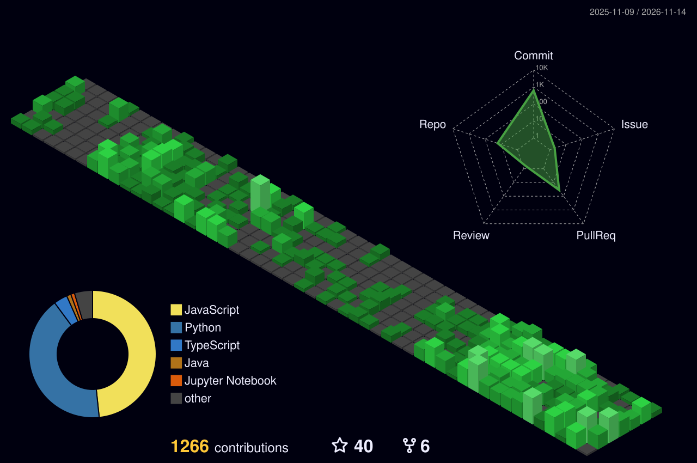

  <a href="http://gdjkhp.github.io">
    
    <h1>Welcome to my awfully maintained GitHub profile!</h1>
    
  </a>
   
  

- 👋 Hi, I’m @GDjkhp
- 👀 I’m interested in playing video games, composing music, watching anime, programming, and procrastinating.
- 📫 How to reach me: https://gdjkhp.github.io

# my half-assed works
- [NoobGPT](https://gdjkhp.github.io/NoobGPT) - A **very simple yet complicated** multi-purpose Discord bot that does pretty much nothing but insult you.
  - <https://github.com/GDjkhp/level-up-loser-python-branch>
- [Noobplayer](https://doopees.gdjkhp.com) - A **very basic yet complex** audio web player that plays copyrighted content straight off Google's servers.
  - <https://github.com/GDjkhp/noobplayer-beta>
- [meeseeks-leaderboard-api](https://gdjkhp.github.io/meeseeks-leaderboard-api) - Pointless efforts to brag your meeseeks rank instead of typing !rank that no one asked.
  - <https://github.com/GDjkhp/meeseeks-leaderboard-api>
- [AmongUsCosmetics](https://www.unknowncheats.me/forum/among-us/521567-amonguscosmetics.html) - Unlocks all in-game cosmetics for the popular Game Among Us.
  - <https://github.com/GDjkhp/AmongUsMenu>
- [ama-facial-recognition](https://gdjkhp.github.io/ama-facial-recognition) - Free to Use AI Face Recognition (O_O)
  - <https://github.com/GDjkhp/ama-facial-recognition>

[More here…](https://github.com/GDjkhp?tab=repositories)

# goofy ahh graph

  
  <!-- 
   -->
  
  
  
  
  
  
  
  
  

<!---
GDjkhp/GDjkhp is a ✨ special ✨ repository because its `README.md` (this file) appears on your GitHub profile.
You can click the Preview link to take a look at your changes.
--->
